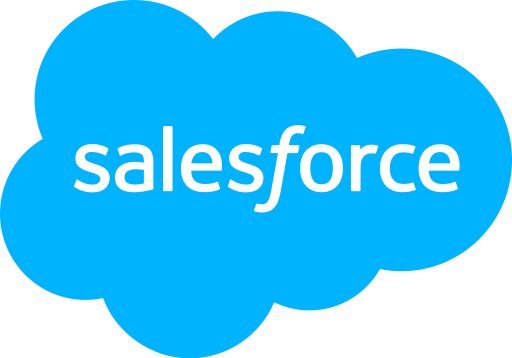
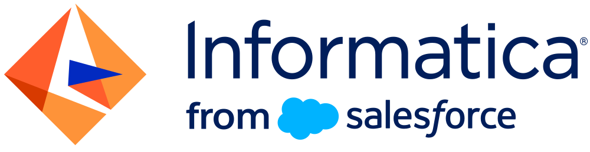
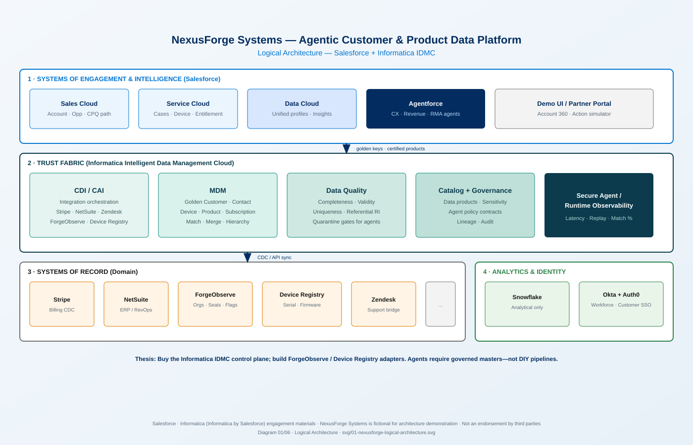

# NexusForge Systems — Agentic Customer & Product Data Platform

<p align="left">
  
  &nbsp;&nbsp;
  
</p>

Customer delivery architecture engagement for **NexusForge Systems** (fictional Technology customer: B2B SaaS observability **ForgeObserve** + edge appliances **ForgeEdge**) on **Salesforce** and **Informatica Intelligent Data Management Cloud (IDMC)**.

| | |
| --- | --- |
| Engagement | Agentic Customer & Product Data Platform |
| Platforms | Salesforce Sales Cloud, Service Cloud, Data Cloud, Agentforce · Informatica IDMC (CDI/CAI, MDM, DQ, Catalog, Governance) |
| Tone | Principal solution architecture / SOW delivery — not interview framing |



## Purpose

Unify Account, Contact, Subscription/Entitlement, Product/SKU, and Device masters so Agentforce pilots (trial conversion, entitlement triage, proactive RMA, ARR briefs) consume **governed, certified data products** at runtime — not ad-hoc warehouse snapshots. Thesis: AI can scaffold pipelines in a day; it cannot replace the **trust fabric** (identity resolution, survivorship, policy, lineage, agent-time contracts). **Buy the control plane (Salesforce + IDMC); build the adapters** (ForgeObserve, Device Registry).

## Three pillars

1. **Data Integration** — IDMC CDI/CAI as fabric of record; CDC from Stripe/NetSuite; API connectors; &lt;5 min consistency SLA; agent tools via governed APIs only.
2. **Master Data Management** — Informatica MDM golden records; hierarchy; crosswalk IDs into Salesforce + Data Cloud.
3. **Data Governance** — Catalog data products, sensitivity tags, DQ gates, deny raw billing tokens to agents, lineage on every write-back.

## Quickstart

```bash
# Docs first
open docs/00-engagement-overview.md   # or read in editor
open docs/deploy/01-prerequisites.md

# Demo UI (static)
cd demo-app
npm start
# → http://localhost:4173
# or: python3 -m http.server 4173
```

Deploy sequence (expand in `docs/deploy/`): prerequisites → IaC → Salesforce baseline → IDMC foundation → MDM → DQ/Catalog → Data Cloud → Agentforce → demo → UAT → go-live → ops.

## Architecture diagrams

All branded SVGs live under **`diagrams/svg/`** only (inventory path). There is no separate root `svg/` directory.

| # | File | Content |
| --- | --- | --- |
| 01 | [`diagrams/svg/01-nexusforge-logical-architecture.svg`](diagrams/svg/01-nexusforge-logical-architecture.svg) | Logical architecture — engagement, trust fabric, SoRs, analytics, identity |
| 02 | [`diagrams/svg/02-nexusforge-integration-mdm-governance-pillars.svg`](diagrams/svg/02-nexusforge-integration-mdm-governance-pillars.svg) | Integration · MDM · Governance pillars |
| 03 | [`diagrams/svg/03-nexusforge-data-flow-subscription-device.svg`](diagrams/svg/03-nexusforge-data-flow-subscription-device.svg) | Subscription + device data flow |
| 04 | [`diagrams/svg/04-nexusforge-agentforce-runtime-trust.svg`](diagrams/svg/04-nexusforge-agentforce-runtime-trust.svg) | Agentforce runtime trust / allow-deny |
| 05 | [`diagrams/svg/05-nexusforge-security-identity-boundaries.svg`](diagrams/svg/05-nexusforge-security-identity-boundaries.svg) | Security & identity boundaries |
| 06 | [`diagrams/svg/06-nexusforge-deploy-topology.svg`](diagrams/svg/06-nexusforge-deploy-topology.svg) | Non-prod → UAT → production deploy topology |
| 07 | [`diagrams/svg/07-nexusforge-mdm-logical-hierarchy.svg`](diagrams/svg/07-nexusforge-mdm-logical-hierarchy.svg) | MDM logical hierarchy |
| 08 | [`diagrams/svg/08-nexusforge-data-lineage-path.svg`](diagrams/svg/08-nexusforge-data-lineage-path.svg) | Mandatory data lineage path |
| 09 | [`diagrams/svg/09-nexusforge-subscription-sla-sequence.svg`](diagrams/svg/09-nexusforge-subscription-sla-sequence.svg) | Subscription consistency SLA sequence |

Each diagram includes Salesforce + Informatica/IDMC corner stamps, engagement title, and fictional-customer disclaimer footer. No ASCII/text diagrams are used in this repository.

## Repo layout

- `README.md` — this file
- `branding/logos/` — official Salesforce + Informatica marks ([sources](branding/logos/SOURCES.md))
- `diagrams/svg/` — branded architecture SVGs (01–09)
- `demo-app/` — Account 360 + Agentforce simulator
- `docs/` — architecture, pillars, deploy, acceptance
- `salesforce/` — force-app metadata + scripts
- `idmc/` — cai, cdi, mdm, dq, catalog
- `infra/` — terraform + scripts
- `tests/` — integration + acceptance

## Salesforce + Informatica branding

Official product naming and Brand Central / corporate marks are required on docs, demo chrome, and diagrams. Assets live in [`branding/logos/`](branding/logos/) (see [`branding/logos/README.md`](branding/logos/README.md) and [`SOURCES.md`](branding/logos/SOURCES.md)):

- `branding/logos/salesforce-cloud-logo.svg` (+ normalized PNG)
- `branding/logos/informatica-from-salesforce-logo.svg` (+ normalized PNG) — official **Informatica from Salesforce** lockup
- `branding/logos/informatica-logo.svg` — Informatica corporate mark alone

## Disclaimer

**NexusForge Systems is a fictional customer** created for architecture demonstration. This repository is not an endorsement by Salesforce, Informatica, or any third-party vendors referenced in integration examples (Stripe, NetSuite, Zendesk, etc.).
