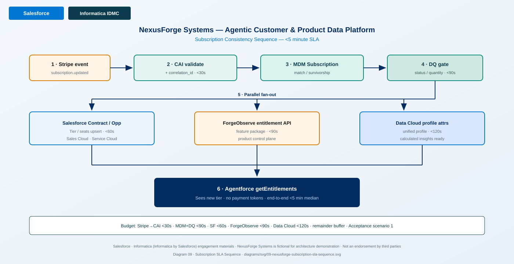

# NexusForge Systems — Integration Catalog

**Solutions:** Salesforce Sales Cloud, Service Cloud, Data Cloud, and Agentforce · Informatica Intelligent Data Management Cloud (IDMC) — Informatica by Salesforce (CDI, CAI, MDM, Data Quality, Catalog, Governance)

| Field | Value |
| --- | --- |
| Customer | NexusForge Systems, Inc. (fictional) |
| Document | 03 — Integration Catalog |
| Version | 1.0 |
| Fabric of record | Informatica IDMC (CAI / CDI) |

---

## 1. Purpose

Catalog the event-driven and scheduled integration patterns that keep CRM, billing, product tenancy, and device state consistent enough for Agentforce. Integrations are **contracts**: idempotent, observable, correlation-ID stamped, and consumable via API-led access—not point-to-point scripts.

**Primary SLA:** &lt;5 minutes median consistency for subscription changes across CRM ↔ billing ↔ product entitlement.

---

## 2. Design principles

1. **IDMC owns orchestration.** Adapters for ForgeObserve and Device Registry are thin; retry, mapping, and monitoring live in CAI/CDI.
2. **Idempotent upserts** into Salesforce, MDM staging, and Data Cloud ingestion.
3. **CDC and webhooks preferred** for subscription and device binding; batch for ERP reconcile.
4. **Correlation ID** on every message and agent invocation.
5. **Poison messages** isolated; replay from DLQ with steward approval for financial writes.
6. **Agents call governed APIs**, never raw connector credentials or warehouse SQL.
7. **Snowflake is sink**, not command path.

---

## 3. Pattern taxonomy

| Pattern ID | Style | Typical latency | Used for |
| --- | --- | --- | --- |
| `P-EVT-CAI` | Event → CAI process | Seconds–minutes | Stripe webhooks, Device Registry bind events |
| `P-CDC-CDI` | CDC → CDI mapping | Minutes | NetSuite customer/item changes |
| `P-SCH-CDI` | Scheduled CDI | Hourly/nightly | Full reconcile, Snowflake publish, DQ batch |
| `P-API-CAI` | Sync API (request/response) | &lt;2s p95 target | Agentforce tool actions, profile retrieve |
| `P-CDC-SF` | Salesforce CDC / Platform Events | Seconds | CRM-originated Account updates into IDMC |
| `P-BH-SECURE` | Secure Agent bridge | Near-real-time | Private Device Registry network path |

---

## 4. System connectors

| System | Connector approach | Auth | Notes |
| --- | --- | --- | --- |
| Salesforce | IDMC Salesforce connector + Connected App | OAuth2 | Upsert by golden / external ID |
| Stripe | CAI HTTPS webhook receiver + Stripe API | Webhook secret + restricted API key | Strip PAN/token from agent-facing payloads |
| NetSuite | CDI NetSuite connector | Token-based auth | Customer, item, invoice summaries |
| Zendesk | CAI REST | OAuth / API token | Sample org/user/ticket link |
| ForgeObserve | Custom REST adapter on CAI | mTLS or OAuth client | Orgs, seats, feature flags |
| Device Registry | Custom REST + optional Secure Agent | mTLS | Serial, firmware, tenant bind |
| Snowflake | CDI Snowflake connector | Key pair | Analytical publish only |
| Data Cloud | Ingestion API / connectors via SF + IDMC | OAuth | Profiles & insights |
| Secrets | Cloud secrets manager refs | — | No secrets in git |

---

## 5. Interface catalog

### 5.1 IF-STRIPE-SUB-01 — Subscription lifecycle

| Field | Value |
| --- | --- |
| Pattern | `P-EVT-CAI` |
| Trigger | `customer.subscription.created/updated/deleted`, `invoice.paid`, `invoice.payment_failed` |
| Target | MDM Subscription staging → golden → Salesforce Contract/Opportunity fields → ForgeObserve entitlement projection → Data Cloud |
| SLA | Median &lt;5 min end-to-end; P95 &lt;15 min |
| Idempotency | Stripe event ID |
| Observability | Lag histogram, failure rate, DLQ depth |

**Payload hygiene:** Persist payment method **status** and brand/last4 if contractually allowed; never persist raw PAN; never publish Stripe secret/publishable misuse; agent products expose `billing_status` only.

### 5.2 IF-STRIPE-CUST-02 — Customer create (PLG)

| Field | Value |
| --- | --- |
| Pattern | `P-EVT-CAI` |
| Trigger | `customer.created` |
| Target | MDM Account candidate → match → Salesforce Account |
| SLA | &lt;5 min median |
| Risk | Duplicate vs existing enterprise Account—MDM match mandatory before create |

### 5.3 IF-NETSUITE-CUST-03 — ERP customer & item CDC

| Field | Value |
| --- | --- |
| Pattern | `P-CDC-CDI` + nightly `P-SCH-CDI` reconcile |
| Target | MDM Account/Product attributes (legal name, bill-to, SKU) |
| SLA | CDC &lt;15 min median; nightly zero-drift reconcile report |

### 5.4 IF-FO-ENT-04 — ForgeObserve entitlement projection

| Field | Value |
| --- | --- |
| Pattern | `P-EVT-CAI` and/or polling fallback `P-SCH-CDI` (5 min) |
| Trigger | Org plan change, seat assignment, feature flag package update |
| Target | MDM Entitlement + Salesforce Entitlement__c + Data Cloud insight inputs |
| SLA | Contributes to &lt;5 min subscription consistency budget |
| Isolation | `forge_org_id` mandatory; cross-tenant writes rejected |

### 5.5 IF-DEV-BIND-05 — Device tenant binding

| Field | Value |
| --- | --- |
| Pattern | `P-EVT-CAI` (+ `P-BH-SECURE` if private) |
| Trigger | Bind, unbind, firmware report, RMA state change |
| Target | MDM Device → Salesforce Device__c → Case linkage |
| SLA | Bind events &lt;5 min median to CRM; RMA state &lt;2 min to Service Cloud |
| DQ gate | Firmware/serial consistency before agent RMA allow |

### 5.6 IF-ZD-SYNC-06 — Zendesk sample sync

| Field | Value |
| --- | --- |
| Pattern | `P-EVT-CAI` / scheduled pull |
| Scope | Pilot sample orgs/users; ticket→Case bridge optional |
| Target | Contact crosswalk; Account link via golden key |
| SLA | Best-effort &lt;15 min; not on critical subscription path |

### 5.7 IF-SF-CDC-07 — Salesforce outbound

| Field | Value |
| --- | --- |
| Pattern | `P-CDC-SF` → CAI/CDI |
| Trigger | Account/Contact ownership and hierarchy updates from AE |
| Target | MDM attribute updates per survivorship (AE owner wins from SF) |

### 5.8 IF-AGENT-API-08 — Agentforce governed actions

| Field | Value |
| --- | --- |
| Pattern | `P-API-CAI` |
| Operations | `getAccount360`, `getEntitlements`, `proposeRma`, `createFollowUpTask`, `getRenewalBrief` |
| Auth | Salesforce Named Credential → CAI; scoped OAuth |
| SLA | Profile retrieve p95 &lt;2s |
| Policy | Catalog enforcement; deny raw billing token fields |
| Audit | Correlation ID + agent session ID + allow/deny |

### 5.9 IF-SNOW-PUB-09 — Snowflake analytical publish

| Field | Value |
| --- | --- |
| Pattern | `P-SCH-CDI` |
| Content | Certified aggregates, match-rate snapshots, DQ scores |
| Constraint | No agent write-back; no uncertified PII dumps |

### 5.10 IF-DC-INGEST-10 — Data Cloud ingestion

| Field | Value |
| --- | --- |
| Pattern | CDI/CAI → Data Cloud ingestion |
| Content | Golden masters + insight source fields |
| Cadence | Near-real-time for entitlement/device deltas; batch for historical |

---

## 6. Subscription consistency sequence (&lt;5 min SLA)

**Budget allocation (guidance):** Stripe→CAI &lt;30s; MDM+DQ &lt;90s; SF upsert &lt;60s; ForgeObserve &lt;90s; Data Cloud visibility &lt;120s; remainder buffer.

Acceptance scenario 1 validates this path end-to-end.

**Diagrams:**
- Sequence: [`diagrams/svg/09-nexusforge-subscription-sla-sequence.svg`](../diagrams/svg/09-nexusforge-subscription-sla-sequence.svg)
- Broader CDC flow: [`diagrams/svg/03-nexusforge-data-flow-subscription-device.svg`](../diagrams/svg/03-nexusforge-data-flow-subscription-device.svg)

---

## 7. Correlation IDs and observability

### 7.1 Correlation ID standard

| Field | Rule |
| --- | --- |
| Name | `X-NF-Correlation-Id` (HTTP); `correlation_id` (JSON body/events) |
| Format | UUIDv4 |
| Propagation | Stripe event processing creates ID if absent; passes to MDM, SF, product, agent audit |
| Agent | New ID per tool invocation; parent session ID linked |

### 7.2 Metrics (minimum)

| Metric | Alert |
| --- | --- |
| `integration_lag_ms{interface}` | P50 &gt;5 min on IF-STRIPE-SUB-01 |
| `integration_success_ratio` | &lt;99.5% over 1h |
| `dlq_depth` | &gt;0 for 15 min on financial interfaces |
| `duplicate_account_create_rate` | &gt;0.1% |
| `agent_tool_deny_total` | Informational + spike investigation |
| `mdm_match_rate` / `dq_fail_rate` | Per ops runbook thresholds |

### 7.3 Logging

Structured JSON logs in IDMC and adapter runtimes: `interface_id`, `correlation_id`, `golden_*` keys when known, `result`, `error_code`. No raw secrets or full payment payloads in logs.

### 7.4 Replay

- DLQ replay via CAI operations console with dual-control for Stripe-impacting writes.
- Idempotency keys prevent double seat grants.

---

## 8. API-led Agentforce access

Agents never hold Stripe/NetSuite credentials. Tooling maps to CAI processes:

| Tool | Backing interface | Data products |
| --- | --- | --- |
| Account 360 retrieve | IF-AGENT-API-08 | `dp.customer.golden` |
| Entitlement check | IF-AGENT-API-08 | `dp.entitlement.active` |
| Device fleet summary | IF-AGENT-API-08 | `dp.device.fleet` |
| Propose RMA | IF-AGENT-API-08 → Device Registry | `dp.device.fleet` (must be certified) |
| Renewal brief | IF-AGENT-API-08 | golden + entitlement (read-only) |

Denied fields return policy error codes consumed by Agentforce for user-visible safe fallback (“billing status unavailable—escalate”).

---

## 9. Error handling matrix

| Class | Example | Response |
| --- | --- | --- |
| Transient | 429/503 from Stripe | Exponential backoff; keep correlation ID |
| Mapping | Unknown Stripe price | SKU steward queue; block entitlement enable |
| DQ | Serial/firmware mismatch | Quarantine; agent escalate (scenario 4) |
| Security | Tool requests raw token field | Deny + audit (scenario 3) |
| Isolation | Org A agent accessing Org B device | Hard fail; page on-call |
| Poison | Malformed webhook | DLQ; alert integration owner |

---

## 10. Non-functional targets

| Area | Target |
| --- | --- |
| Critical subscription sync availability | 99.9% monthly |
| Job success rate | ≥99.5% |
| Duplicate Account creates from sync | &lt;0.1% |
| Agent profile p95 | &lt;2s |
| Growth | 3× accounts/devices without pattern redesign |

---

## 11. Ownership

| Interface family | Owner |
| --- | --- |
| Stripe / NetSuite | RevOps + Integration lead |
| ForgeObserve / Device Registry | Product Eng + Integration lead |
| Salesforce CDC / Data Cloud | Salesforce workstream |
| Agent APIs / policy | CDO + CISO + EA |
| Observability dashboards | Platform Ops |

Specs: `idmc/cai/`, `idmc/cdi/`. Deploy steps: [deploy/04-integrations.md](./deploy/04-integrations.md).

---

*Disclaimer: NexusForge Systems is a fictional customer created for Salesforce and Informatica (Informatica by Salesforce / IDMC) architecture demonstration purposes. This material is not an endorsement by, or affiliation with, any named third-party company.*
