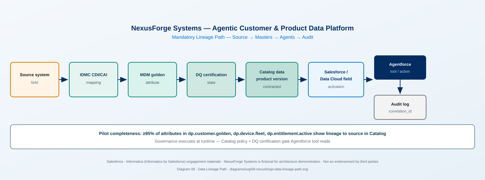

# NexusForge Systems — Governance and Policies

**Solutions:** Salesforce Sales Cloud, Service Cloud, Data Cloud, and Agentforce · Informatica Intelligent Data Management Cloud (IDMC) — Informatica by Salesforce (Catalog, Governance, Data Quality, MDM, CDI, CAI)

| Field | Value |
| --- | --- |
| Customer | NexusForge Systems, Inc. (fictional) |
| Document | 04 — Governance and Policies |
| Version | 1.0 |
| Compliance drivers | SOC 2 Type II, ISO 27001, GDPR, CCPA |

---

## 1. Purpose

Agentic AI reshapes governance from periodic policy PDFs to **continuous, machine-readable policy** at discovery and action time. This document defines data products, sensitivity classification, Agentforce tool denials, lineage expectations, DQ gates, and compliance alignments for NexusForge.

**Success targets:** 100% of agent-consumed data products cataloged with owner + sensitivity; lineage completeness ≥95% for pilot domains; zero critical DQ gate bypasses in production pilot.

---

## 2. Governance operating model

| Role | Responsibility |
| --- | --- |
| CDO / Head of Data Platform | Data product portfolio; DQ standards |
| Data product owner | SLA, schema versioning, certification |
| Data steward | Quarantine resolution; match exceptions |
| CISO / Privacy counsel | Sensitivity taxonomy; agent deny lists; DSR process |
| Salesforce / Agentforce admin | Tool permissions; Event Monitoring |
| Platform Ops | Lineage/DQ/allow-deny dashboards |

**Principle:** If an attribute is not in a certified data product, Agentforce tools must not retrieve it.

---

## 3. Data products (pilot)

### 3.1 `dp.customer.golden`

| Field | Value |
| --- | --- |
| Description | Golden Account/Customer profile for CX and revenue agents |
| Grain | `golden_account_id` |
| Owner | Customer Master steward (CDO org) |
| SLA | Freshness ≤5 min from MDM publish for pilot attributes |
| Certified consumers | Trial coach, triage, RMA, renewal brief, Account 360 UI |
| Sensitivity | `PII-indirect`, `Commercial-confidential` |

**Included (illustrative):** legal/DBA name, hierarchy role, segment, AE owner, domains, golden keys, match score, billing entity pointers.

**Excluded:** tax ID full value in agent tier (masked); internal legal hold notes.

### 3.2 `dp.device.fleet`

| Field | Value |
| --- | --- |
| Description | Active ForgeEdge fleet by Account with bind confidence |
| Grain | `golden_device_id` |
| Owner | Hardware / Device Registry platform + MDM steward |
| SLA | Bind events ≤5 min; RMA state ≤2 min |
| Certified consumers | Proactive RMA agent, Service Cloud Device panel |
| Sensitivity | `Operational`, `Customer-asset` (serial may be contractual confidential) |

**Included:** serial, model, firmware (certified), tenant org, golden Account, RMA status, bind confidence, DQ status.

**Excluded:** raw device debug dumps; customer packet payloads; uncertified firmware strings failing DQ.

### 3.3 `dp.entitlement.active`

| Field | Value |
| --- | --- |
| Description | Active subscription and product entitlement projection |
| Grain | `golden_subscription_id` (+ Account) |
| Owner | RevOps + Product entitlements |
| SLA | Contributes to &lt;5 min CRM↔billing↔product consistency |
| Certified consumers | Triage, trial coach, renewal brief |
| Sensitivity | `Commercial-confidential`; billing token fields **prohibited** |

**Included:** tier, seats purchased/used, feature flags summary, `billing_status` (`active` \| `past_due` \| `trialing` \| `canceled`), renew date, support SLA tier.

**Excluded:** Stripe payment method IDs, customer tax IDs bank details, raw invoice PDF binaries in agent path, **any PAN or payment token**.

---

## 4. Sensitivity taxonomy

| Tag | Meaning | Agent default |
| --- | --- | --- |
| `Public` | Marketing-safe | Allow |
| `Internal` | Workforce only | Allow with workforce SSO context |
| `Commercial-confidential` | Pricing, ARR components | Allow for scoped revenue/CX agents |
| `PII` | Direct identifiers | Allow minimized; purpose-limited |
| `PII-sensitive` | Government ID, precise geo where applicable | Deny for pilot agents |
| `Payment-restricted` | PAN, payment tokens, full PM IDs | **Deny** |
| `Tenant-secret` | Customer API keys, auth secrets in product | **Deny** |
| `Export-controlled` | Restricted appliance SKUs | Allow metadata only; block shipment actions |

Tags live in IDMC Catalog on columns/attributes and are enforced at CAI agent API responses.

---

## 5. Agentforce tool policies

### 5.1 Deny — raw Stripe PAN / tokens

| Policy ID | `POL-AGENT-DENY-STRIPE-TOKEN` |
| --- | --- |
| Rule | Any Agentforce tool request for attributes tagged `Payment-restricted` (e.g., `stripe_payment_method_token`, raw PAN, secret key material) is **denied** |
| Allowed alternative | `billing_status`, last4/brand if approved under `Commercial-confidential`, portal deep link for human billing admin |
| Enforcement | IDMC Catalog/Governance + CAI response filter + Salesforce tool permission allowlist |
| Audit | `agent_tool_deny` event with correlation ID, agent ID, field path |
| Acceptance | Scenario 3 in [acceptance/scenarios.md](./acceptance/scenarios.md) |

### 5.2 Deny — cross-tenant access

| Policy ID | `POL-AGENT-DENY-CROSS-TENANT` |
| --- | --- |
| Rule | Device or entitlement retrieve must include `forge_org_id` consistent with golden Account authorization context |
| Effect | Hard fail; security alert |

### 5.3 Purpose limitation

| Agent | Allowed purposes |
| --- | --- |
| Trial conversion coach | Conversion coaching; no refunds |
| Entitlement triage | Support routing; no payment capture |
| Proactive RMA | Hardware service; HITL for cross-Account rebind |
| ARR/renewal brief | Read-only analytics narrative |

### 5.4 HITL thresholds (policy-linked)

| Action | Threshold | Policy |
| --- | --- | --- |
| Refund / credit | &gt; $500 USD or any non-pilot agent | Require human approval (pilot: refunds generally out of scope) |
| Device rebind across Accounts | Any | Require steward + Service lead |
| Entitlement grant outside Stripe state | Any | Deny; RevOps only |

---

## 6. Lineage requirements

### 6.1 Mandatory lineage path (pilot domains)



**Diagram:** [`diagrams/svg/08-nexusforge-data-lineage-path.svg`](../diagrams/svg/08-nexusforge-data-lineage-path.svg)

### 6.2 Completeness target

≥95% of attributes in `dp.customer.golden`, `dp.device.fleet`, and `dp.entitlement.active` show lineage to source in Catalog.

### 6.3 Buy-vs-build note

Lineage graphs and match-rate dashboards are first-class IDMC capabilities. DIY AI-scaffolded pipelines typically omit enforceable lineage—acceptance scenario 5 demonstrates this operational gap.

---

## 7. Data Quality gates

### 7.1 Gate classes

| Gate | Example rule | On failure |
| --- | --- | --- |
| Completeness | Account domain or Stripe ID present for paying Accounts | Quarantine; block certification |
| Validity | `billing_status` ∈ allowed enum | Quarantine |
| Uniqueness | One active golden Device per serial | Quarantine + alert |
| Referential | Device `golden_account_id` exists and active | Block RMA agent action |
| Consistency | Firmware string matches model allowlist | Quarantine (RMA scenario) |
| Freshness | Entitlement older than SLA budget | Degrade agent confidence; warn |

### 7.2 Certification states

`draft` → `in_review` → `certified` → `revoked`

Agent tools read **certified** only. Revocation immediately denies new tool reads (cached TTL ≤60s for pilot).

### 7.3 Critical bypass

Production pilot: **zero** critical DQ gate bypasses. Break-glass requires CDO + CISO dual approval and ticket.

---

## 8. Compliance mapping

### 8.1 SOC 2 Type II (aligned controls)

| Trust criteria theme | Control in this architecture |
| --- | --- |
| Security | Secrets in vault; least privilege; deny payment-restricted fields |
| Availability | 99.9% target on critical sync; DLQ monitoring |
| Processing integrity | Idempotent upserts; DQ gates; MDM survivorship |
| Confidentiality | Sensitivity tags; tenant isolation tests |
| Privacy | Consent constructs in Data Cloud; DSR path via masters |

Evidence: IDMC job logs, Catalog policy hits, Salesforce Event Monitoring, agent allow/deny metrics.

### 8.2 GDPR / CCPA

| Obligation | Implementation |
| --- | --- |
| Lawful basis / notice | Existing NexusForge privacy program; agents inherit purpose limitation |
| Access / delete (DSR) | Locate subject via golden Contact/Account crosswalk; propagate delete/suppress via CAI to CRM, support sample, marketing; billing retention per legal hold |
| Data minimization | Agent products expose minimized attribute sets |
| Subprocessors | Salesforce + Informatica IDMC as platform processors per customer MSA |
| Regional considerations | DPA region on Account; avoid transferring unnecessary PII to analytical plane |

### 8.3 ISO 27001 alignment

Access control, logging, change management for match rules (see ops runbook), and supplier security questionnaires for Salesforce/Informatica.

### 8.4 Multi-tenant isolation

Automated acceptance tests attempt cross-org device reads; pipeline fails closed. Product Eng owns ForgeObserve enforcement; IDMC/CAI enforces org_id presence.

---

## 9. Catalog entry template

```yaml
data_product: dp.entitlement.active
version: 1.2.0
owner: revops-entitlements@nexusforge.example
certification: certified
sla:
  freshness_median_seconds: 300
sensitivity_default: Commercial-confidential
attributes:
  - name: billing_status
    sensitivity: Commercial-confidential
    agent_access: allow
  - name: stripe_payment_method_token
    sensitivity: Payment-restricted
    agent_access: deny
consumers:
  - agentforce.entitlement_triage
  - agentforce.trial_coach
lineage_completeness_pct: 97
```

Repo specs: `idmc/catalog/`, `idmc/dq/`.

---

## 10. Change control

| Change type | Approval |
| --- | --- |
| New agent-consumed attribute | Product owner + CISO sensitivity review |
| Match rule change | MDM steward + EA; logged in ops runbook |
| Policy deny list change | CISO mandatory |
| Break-glass DQ bypass | CDO + CISO; time-boxed |
| Data product major version | Consumer contract review; Agentforce regression |

---

## 11. Metrics and dashboards

- % catalog coverage for agent tools  
- Policy deny counts (`POL-AGENT-DENY-STRIPE-TOKEN`)  
- DQ fail rate by domain  
- Lineage completeness  
- Certification freshness  
- DSR cycle time (operational KPI for privacy ops)

---

## 12. Related documents

- [02-data-model-mdm.md](./02-data-model-mdm.md) — masters  
- [03-integration-catalog.md](./03-integration-catalog.md) — interfaces  
- [05-agentforce-use-cases.md](./05-agentforce-use-cases.md) — HITL  
- [acceptance/scenarios.md](./acceptance/scenarios.md) — scenarios 3–5  

---

*Disclaimer: NexusForge Systems is a fictional customer created for Salesforce and Informatica (Informatica by Salesforce / IDMC) architecture demonstration purposes. This material is not an endorsement by, or affiliation with, any named third-party company.*
